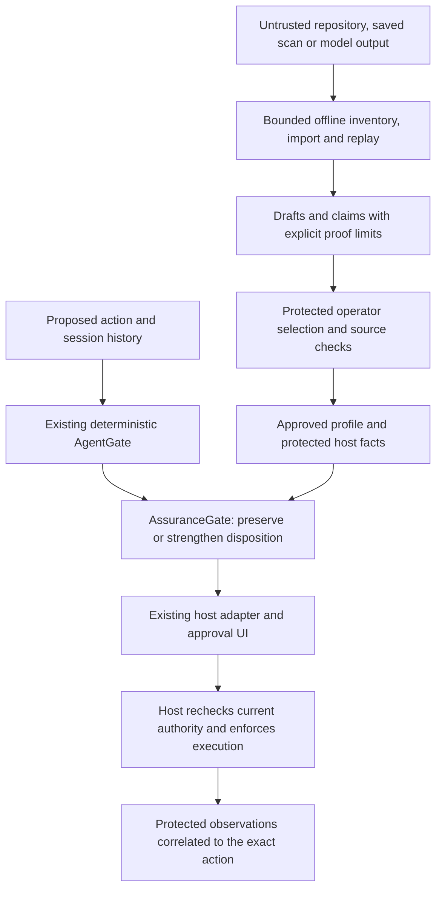

# Assurance security and privacy

Default imports, ordinary `Ordin`/`AgentGate`, profile validation and local
inventory do not contact a scanner or hosted model. Repository files, comments,
instruction documents, imported artifacts and model output remain untrusted.
Only separately protected host APIs select profiles or issue trusted evidence.
Ordinary JSON decoding cannot activate authority.

Deterministic core reviews reuse catalog bytes only within the current review.
The scope reads each retained file afresh, returns independently decoded values,
and checks exact bytes, directory membership, missing-file selections, catalog
environment and loader roots again before returning a result. Changed inputs
raise a coarse `ValueError`; existing host adapters refuse that failed review.
Scopes are discarded on success or error and are isolated across threads and
async tasks. Extra or oversized catalogs use the original fresh-read path rather
than extending the bounded retained state. This is not a persistent data cache
or execution authority, and the host still rechecks current resources at use.

The offline path creates analysis data. The pre-execution path uses separately
protected configuration and host facts, then preserves the host's own approval,
execution and observation boundaries:

Offline records cannot supply the protected selection or enforcement shown in
this diagram. Optional model/scanner calls need separate explicit host consent;
their outputs enter as claims rather than operator authority. Unsupported scope
and missing required evidence remain inconclusive or refuse execution according
to the selected invariant's documented failure behavior.

Repository/file readers anchor to an explicit authorized directory, reject
traversal, symlinks/reparse points, hardlinks, remote/device namespaces and
nonregular files, and bound bytes/nesting/counts. POSIX directory descriptors
use `O_NOFOLLOW`. Windows retains directory handles without delete sharing,
opens reparse points themselves and validates the actual file handle/link count;
it also avoids recalling offline storage. Sharing flags remain effective while
handles are open, and delete access covers renaming. These are the platform
semantics documented by [Microsoft's CreateFileW reference](https://learn.microsoft.com/en-us/windows/win32/api/fileapi/nf-fileapi-createfilew)
and [Python's descriptor APIs](https://docs.python.org/3/library/os.html#os.open).
Failed opens release handles; snapshot verification catches changed source.

Private profile/analysis artifacts can contain exact asset/source references.
Treat `as_dict()` as local private serialization. Public Markdown rendering
redacts paths/assets by default and requires an explicit flag to reveal them.
Raw source, secret values, tool-output bodies and repository instructions are
not retained by the inventory. Hashes preserve correlation, not confidentiality;
low-entropy names and values can be guessed.

Store private evidence and approved configuration outside agent write scope,
with restrictive permissions/ACLs. Use separate directories for raw evidence,
synthetic examples and public reports. Operators own retention, rotation and
manual deletion; stop pending work before changing configuration, revoking host
authority or deleting evidence. No automatic upload, publication, disclosure,
remediation installation, network listener or dashboard is provided.

Protected configuration and capability boundaries are external host obligations.
Declared runtime guarantees must correspond to actually enforced rights and
correct physical/runtime path mappings. Unknown protection refuses activation.
An API verification result is not proof the host installed enforcement. A local
administrator or malicious code inside the trusted host process remains outside
these ordinary file/API protections. Final execution must recheck exact action,
profile, grant, session/epoch and active policy bindings at use time.

The current source inventory is deliberately incomplete analysis. Imported or
static claims do not become observed exploitation, and uninspected deployment
context does not become safety. Real scanner/model setup, third-party licensing,
hosted consent and patch workflows remain separate optional milestones.

Report safety-sensitive vulnerabilities through the private route in
[SECURITY.md](../../SECURITY.md). Keep live secrets, private traces and exploit
details out of public issues and ordinary reports. Finding/fix verification does
not authorize publication or installation; coordinate disclosure and affected
operator review separately.
