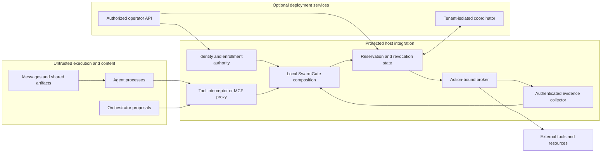
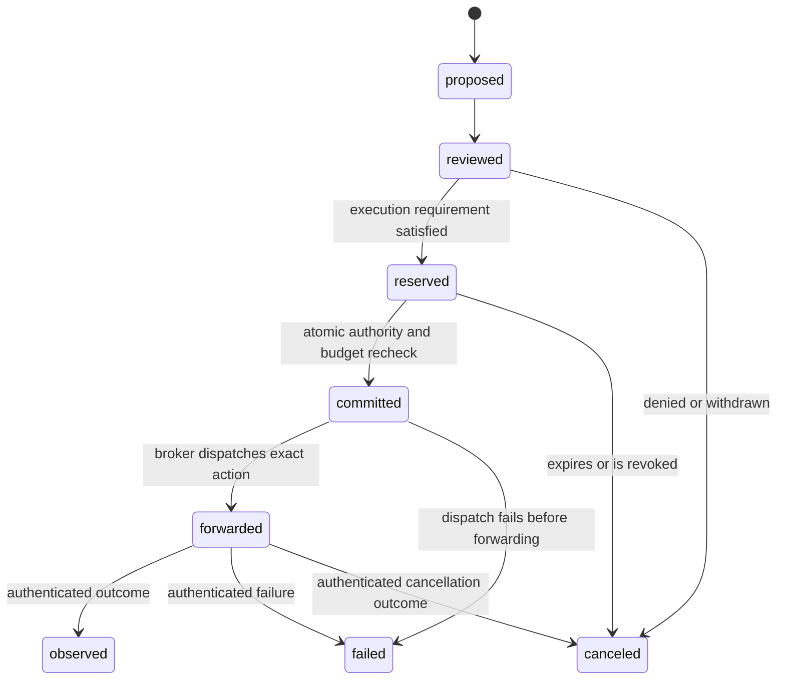

# Opt-in swarm architecture contract

Status: design contract for [SWARM-01](https://github.com/LatentOps/ordin/issues/256).
The swarm registry, `SwarmGate`, coordinator and swarm event protocol described
here are planned components, not shipped enforcement capabilities. See the
[support matrix](support-matrix.md) for current boundaries and the
[threat model](threat-model.md) for acceptance scenarios.

## Ownership and trust boundaries

| Component | Owns | Must not trust |
| --- | --- | --- |
| Agent | Proposals, arguments, generated text | Its own identity, risk labels, approvals or completion claims |
| Orchestrator | Scheduling and proposed task/delegation relationships | An agent-supplied parent, tenant or authority extension |
| Host | Protected tenant/swarm/agent/session/task bindings, enrollment generations and admission configuration | Serialized identity without authenticated host issuance |
| Interceptor/proxy | Normalization and interception of covered future calls | A tool description as authority; direct calls bypassing the interceptor |
| Local gate | Monotonic composition of core, session, Assurance and swarm requirements | Semantic scores as permits; missing context as safety |
| Coordinator | Optional durable cross-host reservations, event ordering and revocation fences | A remote client claiming another tenant or a stale generation |
| Broker | Use-time validation and actual dispatch within controlled capabilities | A reviewed proposal as proof of execution or an advisory policy as installed policy |
| Collector | Authenticated observation of its configured boundary | Caller JSON, a tool's self-report, or collection gaps as complete evidence |
| Operator | Explicitly scoped enrollment, policy, approval and incident operations | A request in agent text as operator consent; unsigned remote configuration |

These are separate privileges even if a local deployment places components in
one process. Host and broker code are trusted; hostile code sharing their memory
or credentials can defeat an in-process boundary. Compromised kernels, protected
host administrators and colluding authorized operators are outside this model;
their compromise must not be described as detectable or preventable by a gate.

## Decision and execution lifecycle

This is the planned swarm event vocabulary, not a new interpretation of existing
session records. `reviewed` records a decision, including `warn`, `ask` and
`block`; it is not permission to reserve. A reservation must bind exact canonical
arguments, identity, capabilities, policy epoch, delegation generation, expiry
and resource budget. Commit consumes the reservation once and rechecks those
bindings at the broker's dispatch boundary. A software commit alone does not
revoke an OS handle or prove forwarding.

Each event must carry authenticated issuer identity, tenant and session scope,
an action ID, unique event ID, sequence/epoch and causal references. Retries must
be idempotent within bounded retention; changed payloads under one ID are
rejected. Out-of-order events can be retained within an explicit bounded window
but cannot invent missing stages. A missing or unauthenticated stage is unknown.
A post-forward cancellation does not prove rollback. An observation cannot
retroactively authorize an earlier action, refund an irreversible effect or
prove absence of unobserved activity. Budget release requires an authenticated
pre-forward cancellation; unknown outcomes retain the conservative reservation
until explicit reconciliation.

## Composition and existing code reuse

| Existing surface | Planned reuse | Limit that remains |
| --- | --- | --- |
| [`ordin/agent.py`](../../ordin/agent.py) `AgentGate` | Normalize and review each proposal through the existing core | Review never executes an action |
| [`ordin/action.py`](../../ordin/action.py) `ActionEnvelope` | Keep the public proposal format; place authenticated swarm metadata in a separate host-owned context | Caller envelope fields cannot issue identity |
| [`ordin/session.py`](../../ordin/session.py) `IntegrationSession` | Maintain bounded per-session action and observation history | Sibling histories stay isolated; no implicit global memory |
| [`ordin/temporal.py`](../../ordin/temporal.py) | Reuse deterministic bounded temporal review | Cross-agent composition needs authenticated causal transfer, not concatenated histories |
| [`ordin/assurance/gate.py`](../../ordin/assurance/gate.py) `AssuranceGate` | Preserve profile checks and conservative evidence dispositions | Unknown evidence cannot establish satisfaction |
| [`ordin/assurance/host.py`](../../ordin/assurance/host.py) | Reuse protected evidence, request and capability authority patterns | In-process seals are not portable distributed credentials |
| [`ordin/assurance/delegation.py`](../../ordin/assurance/delegation.py) and [`delegating_gate.py`](../../ordin/assurance/delegating_gate.py) | Reuse subset checks, generation/expiry checks and action-bound single-use tickets | Existing issuer locks are local, not a multihost transaction service |
| [`ordin/assurance/source_flow.py`](../../ordin/assurance/source_flow.py) | Carry authenticated source scope and conservative lineage findings | Complete collected bytes do not establish model persuasion or missing causal edges |
| [`ordin/assurance/adapters.py`](../../ordin/assurance/adapters.py), [`ordin/mcp_proxy.py`](../../ordin/mcp_proxy.py), [`ordin/mcp_http.py`](../../ordin/mcp_http.py) and native hooks | Add enrollment context at existing host interception points | Hooks cover only calls the host actually mediates |
| [`integrations/openshell`](../../integrations/openshell/README.md) | Reuse capability compilation, authority proof, application/readback and trusted event correlation | Advisory compilation is not runtime admission; broker coverage must be independently verified |
| [`ordin/assurance/linux_sandbox.py`](../../ordin/assurance/linux_sandbox.py) | Reuse vetted Linux fixture isolation and evidence boundaries | Fixture acceptance does not prove arbitrary running processes are contained |

The current v0.3 APIs, schema meanings and default local behavior remain intact.
Swarm behavior requires explicit construction/configuration; there is no hidden
registry discovery, network coordination or automatic process attachment.
The future gate takes the strongest requirement under
`allow < warn < ask < block`; it cannot weaken any underlying gate. Neither
`warn` nor `ask` is automatic approval. Human approval must be action-bound and
must not override a core `block` through this composition.

## State, bounds and deployment

The local host is the default authority. The
[local-first ADR](adr-001-local-first-coordination.md) defines when an optional
coordinator is required. All implementations must declare validated limits for
active principals, payload bytes, event retention, causal depth/fan-out,
reservations, policy rules and decision deadlines. Limits are deployment
configuration with documented defaults, never silently unbounded collections.
Exceeding a limit returns an explicit coverage gap or denial, not eviction of
revocation state or an implicit allow.

Enrollment and revocation generations increase monotonically. Broker dispatch
must fence stale tickets after policy changes, revocation, tenant changes and
host recovery. Restarts cannot reset a fence into validity. Distributed authority
requires durable atomic reservations and an authenticated transport; a process
lock or signed JSON alone does not provide either.

High-impact egress, destructive actions, writes, payments and privilege changes
fail closed when necessary identity, policy, reservation or coordinator state
cannot be verified. A deployment may explicitly preissue a narrow offline
capability with a bounded budget and expiry; it must disclose the revocation
latency and cannot claim immediate remote revocation during an outage.

Persist redacted identifiers, digests and dispositions by default. Raw prompts,
secrets, messages and tool results require separate explicit retention settings,
access controls and limits. Tenant scope is checked on every lookup, event,
causal edge, approval and operator operation; opaque IDs alone are insufficient.
